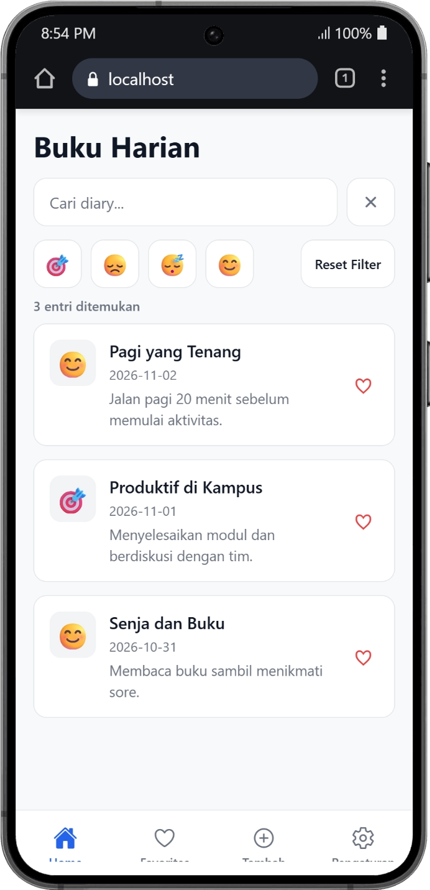
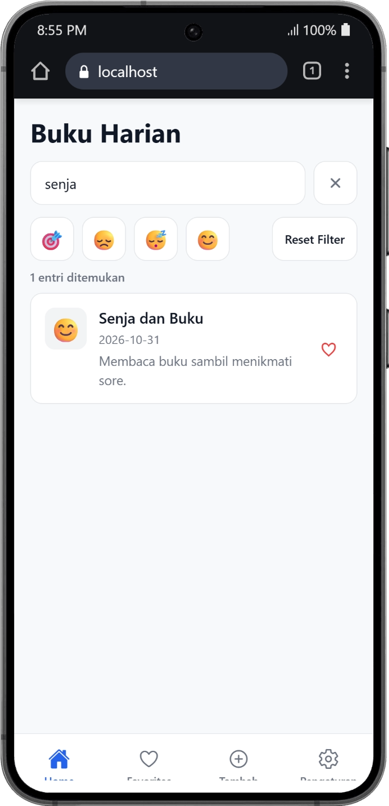
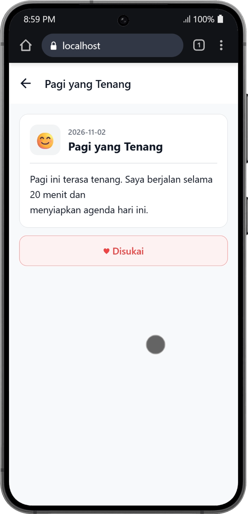
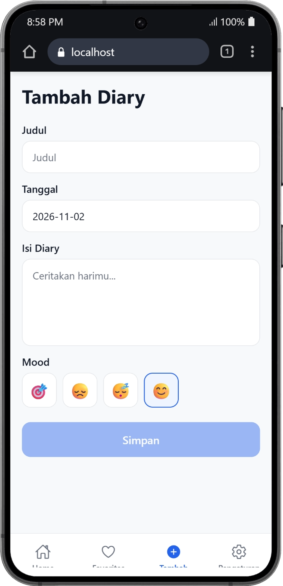
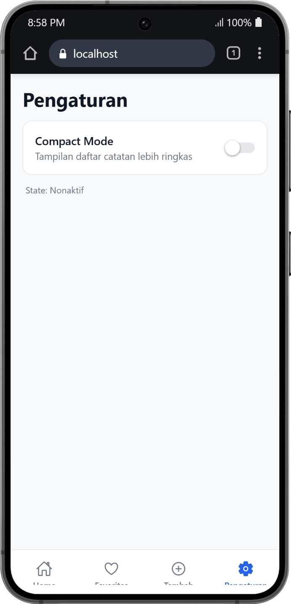
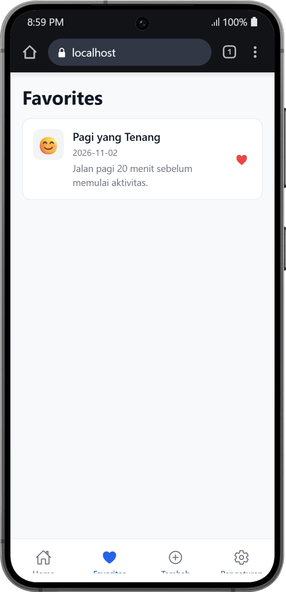

# Diary App - Pertemuan 6

Aplikasi Diary berbasis React Native dan Expo yang dikembangkan untuk praktikum Pemrograman Mobile Multiplatform. Pada pertemuan ini, aplikasi menerapkan React Hooks untuk pencarian, filter mood, pengelolaan Favorites, dan sinkronisasi status Like.

## Disusun Oleh

**Nama:** Muhamad Dikrulloh  
**NIM:** 2430511076

## Cara Menjalankan Project

1. Clone repository pada branch `pertemuan-6`:

   ```bash
   git clone -b pertemuan-6 https://github.com/muhamaddikrulloh/diary-app.git
   ```

2. Masuk ke folder project:

   ```bash
   cd diary-app
   ```

3. Install dependency:

   ```bash
   npm install
   ```

4. Jalankan aplikasi:

   ```bash
   npx expo start
   ```

5. Buka aplikasi melalui Expo Go atau emulator.

## Penerapan React Hooks

| Hook          | Input             | Output                       | Dependency                                  | Alasan Penggunaan                                       |
| ------------- | ----------------- | ---------------------------- | ------------------------------------------- | ------------------------------------------------------- |
| `useState`    | Nilai awal state  | State dan setter             | -                                           | Mengelola query pencarian, filter mood, dan input form. |
| `useContext`  | DiaryContext      | Data dan fungsi dari Context | -                                           | Mengakses data diary dan status Like antarhalaman.      |
| `useEffect`   | Callback debounce | Cleanup timer                | `query`                                     | Menunda pencarian selama 350 ms dan membersihkan timer. |
| `useMemo`     | Fungsi filter     | Daftar diary hasil filter    | `entries`, `debouncedQuery`, `selectedMood` | Mengoptimalkan proses pencarian dan filter mood.        |
| `useCallback` | Fungsi callback   | Referensi fungsi             | `router` atau `setQuery`                    | Menjaga referensi fungsi navigasi dan reset pencarian.  |
| `useRef`      | `null`            | Referensi TextInput          | -                                           | Mengakses dan mengatur fokus input pencarian.           |

## Penerapan Custom Hook

Aplikasi menggunakan dua custom hook untuk memisahkan logika pengolahan data dari komponen tampilan.

### 1. useDiarySearch

Custom hook `useDiarySearch` digunakan untuk mengelola pencarian diary berdasarkan judul atau ringkasan serta filter mood. Pencarian menerapkan debounce selama 350 ms menggunakan `useEffect`, sedangkan `useMemo` digunakan untuk memproses hasil filter.

Hook ini menerima `entries` dan `selectedMood`, kemudian menghasilkan `query`, `setQuery`, `filteredEntries`, dan `resultCount`.

### 2. useLikedEntries

Custom hook `useLikedEntries` digunakan untuk menampilkan diary yang telah diberi Like pada halaman Favorites. Hook ini menggunakan `useMemo` untuk menyaring data berdasarkan ID diary yang disukai.

Hook menerima `entries` dan `likedIds`, kemudian menghasilkan daftar `likedEntries`.

## Screenshot

|                  Home                  |                   Search                   |
| :------------------------------------: | :----------------------------------------: |
|  |  |

|                   Detail                   |                   Create                   |
| :----------------------------------------: | :----------------------------------------: |
|  |  |

|                   Settings                    |                    Favorites                    |
| :-------------------------------------------: | :---------------------------------------------: |
|  |  |
