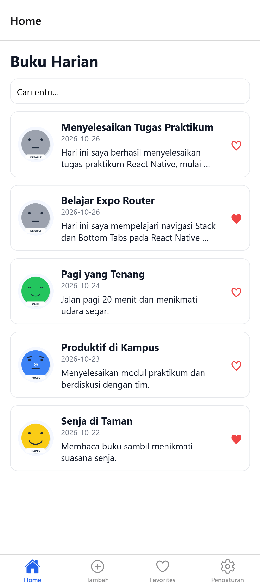
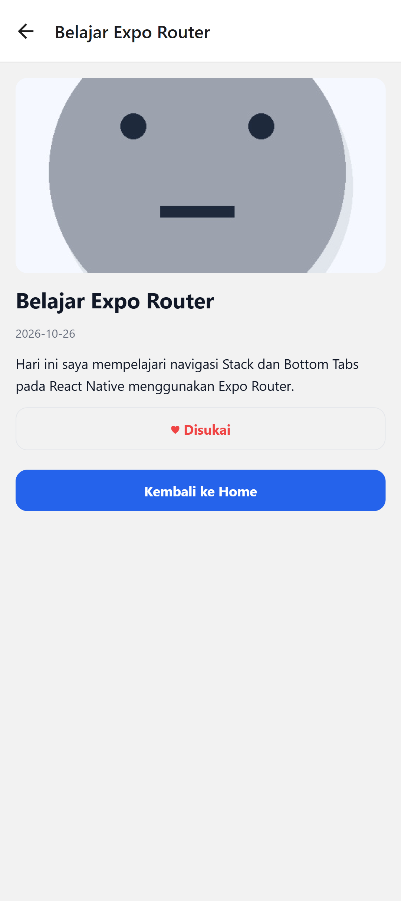
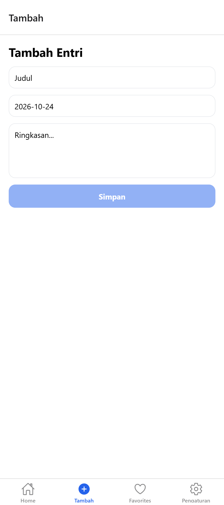
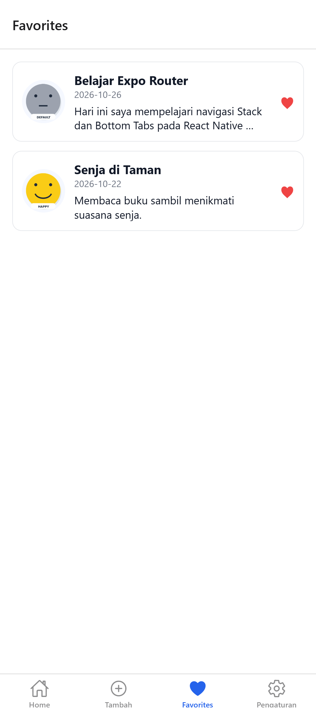
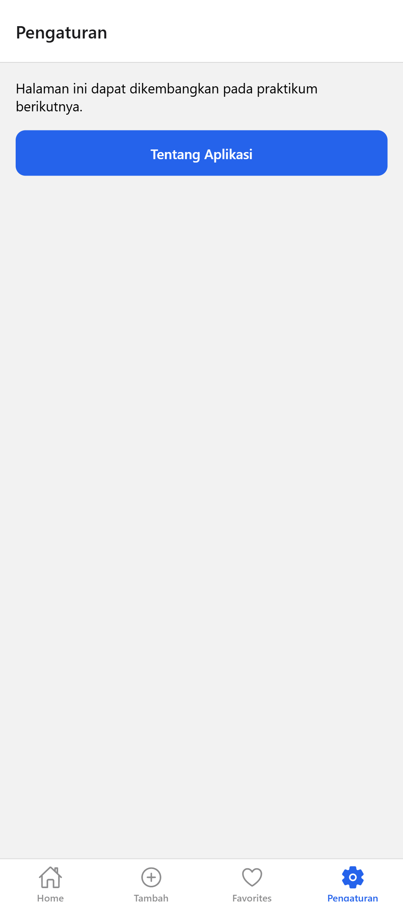
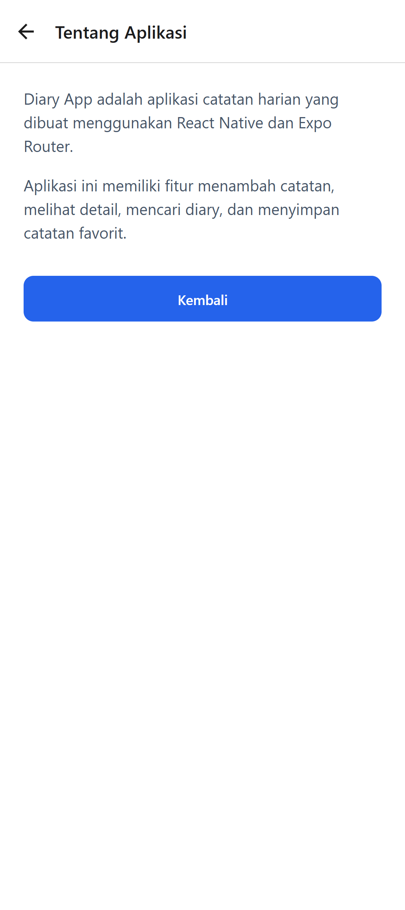

# Diary App - Pertemuan 5

Aplikasi Diary sederhana berbasis React Native dan Expo yang dikembangkan sebagai bagian dari praktikum Pemrograman Mobile Multiplatform. Pada pertemuan ini, aplikasi menerapkan navigasi menggunakan **Expo Router**, meliputi **Stack Navigation**, **Bottom Tabs**, dan **Dynamic Route**, serta **Context API** untuk berbagi data antarhalaman.

## Disusun Oleh

**Nama:** Muhamad Dikrulloh  
**NIM:** 2430511076

## Cara Menjalankan Project

1. Clone repository pada branch `pertemuan-5`:

   ```bash
   git clone -b pertemuan-5 https://github.com/muhamaddikrulloh/diary-app.git
   ```

2. Masuk ke folder project:

   ```bash
   cd diary-app
   ```

3. Install dependency:

   ```bash
   npm install
   ```

4. Jalankan aplikasi menggunakan Expo:

   ```bash
   npx expo start
   ```

5. Scan QR Code menggunakan Expo Go atau jalankan melalui emulator. Untuk menjalankan melalui browser, tekan `w` pada terminal Expo.

## Dependency

Project ini menggunakan:

- React Native
- Expo
- Expo Router
- React Context API
- `@expo/vector-icons` (Ionicons)

## Fitur yang Diselesaikan

- **Bottom Tabs:** Navigasi antara Home, Tambah, Favorites, dan Pengaturan dengan ikon yang sesuai.
- **Home:** Menampilkan daftar diary dan pencarian entri.
- **Tambah Entri:** Menambahkan catatan baru melalui form dan menampilkannya di Home.
- **Favorites:** Menampilkan entri yang diberi Like.
- **Sinkronisasi Like:** Status Like konsisten pada Home, Favorites, dan Detail melalui Context API.
- **Detail Diary:** Menampilkan isi lengkap entri berdasarkan ID melalui Dynamic Route.
- **Kembali ke Home:** Tombol pada Detail untuk menuju halaman Home.
- **Pengaturan dan About:** Halaman tambahan yang dapat dibuka melalui navigasi Stack.
- **Local Assets:** Menggunakan gambar mood `happy`, `focus`, `calm`, dan `default` pada kartu dan detail diary.

## Struktur Route

Aplikasi menggunakan Expo Router dengan struktur folder berikut:

```text
app/
├── _layout.tsx
├── about.tsx
├── (tabs)/
│   ├── _layout.tsx
│   ├── index.tsx
│   ├── create.tsx
│   ├── favorites.tsx
│   └── settings.tsx
└── detail/
    └── [id].tsx
```

## Penerapan Stack, Tabs, dan Dynamic Route

- **Stack Navigation:** Mengatur perpindahan dari halaman utama ke halaman lain, seperti Detail Diary dan About, melalui `app/_layout.tsx`.
- **Bottom Tabs:** Menyediakan empat menu navigasi utama, yaitu Home, Tambah, Favorites, dan Pengaturan, melalui `app/(tabs)/_layout.tsx`.
- **Dynamic Route:** Menggunakan `app/detail/[id].tsx` untuk menampilkan detail diary berdasarkan parameter `id` dari entri yang dipilih.

Struktur ini memisahkan setiap halaman ke dalam route tersendiri sehingga navigasi lebih terorganisasi.

## Penerapan Context API

**Context API** digunakan untuk berbagi data `entries` dan `likedIds` melalui `EntriesProvider`. Fungsi `addEntry()`, `getById()`, dan `toggleLike()` memungkinkan penambahan entri, pengambilan detail, serta sinkronisasi status Like antarhalaman tanpa meneruskan props secara berulang.

Data diary disimpan sementara menggunakan React State, sehingga entri baru dan status Like dapat kembali ke kondisi awal setelah aplikasi dimuat ulang sepenuhnya.

## Screenshot

<table>
  <tr>
    <td align="center" width="50%"><b>Home</b><br></td>
    <td align="center" width="50%"><b>Detail Diary</b><br></td>
  </tr>
  <tr>
    <td align="center"><b>Tambah Entri</b><br></td>
    <td align="center"><b>Favorites</b><br></td>
  </tr>
  <tr>
    <td align="center"><b>Pengaturan</b><br></td>
    <td align="center"><b>Tentang Aplikasi</b><br></td>
  </tr>
</table>
