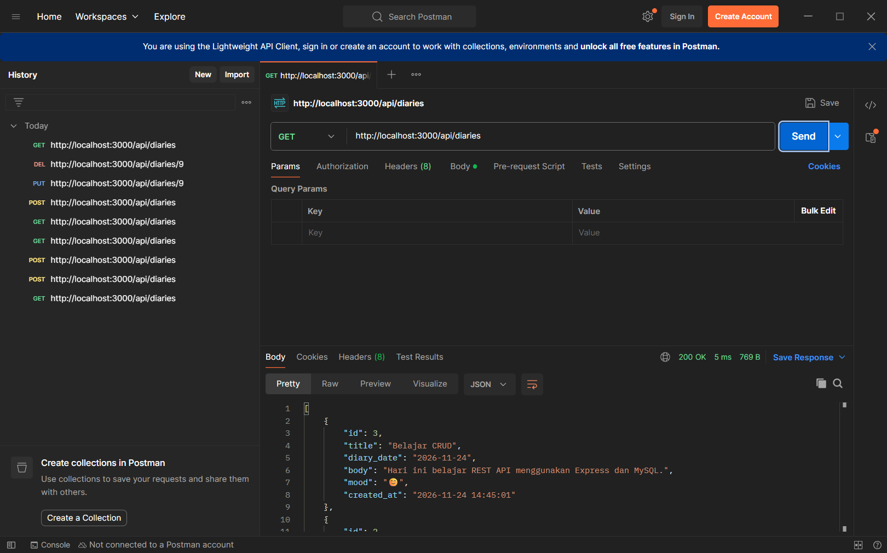
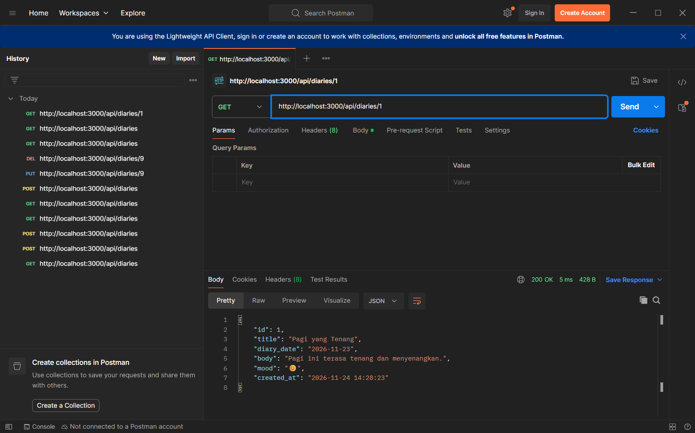
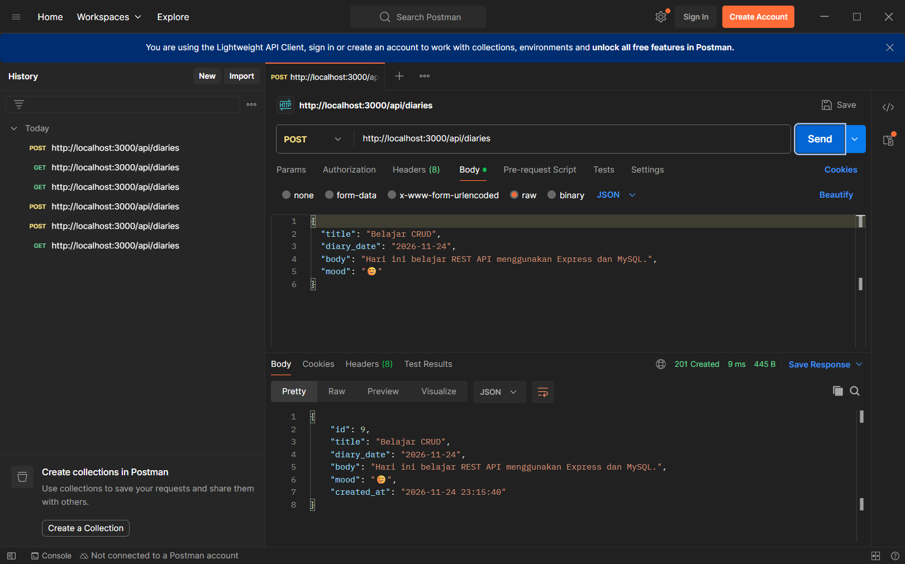
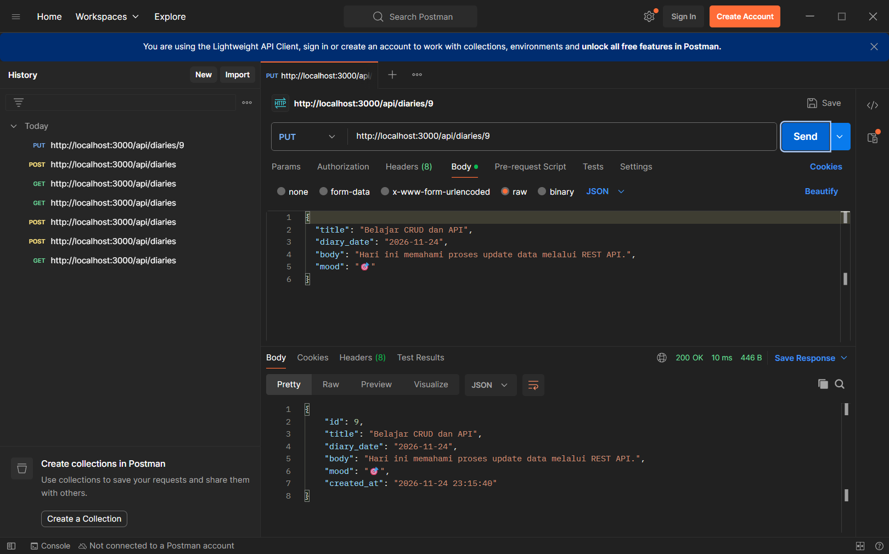
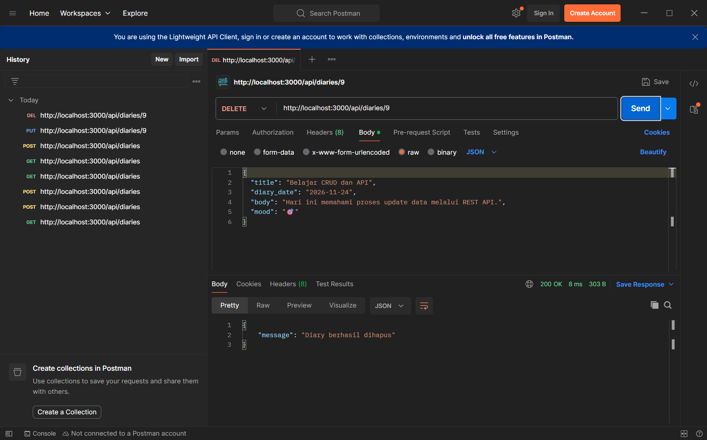
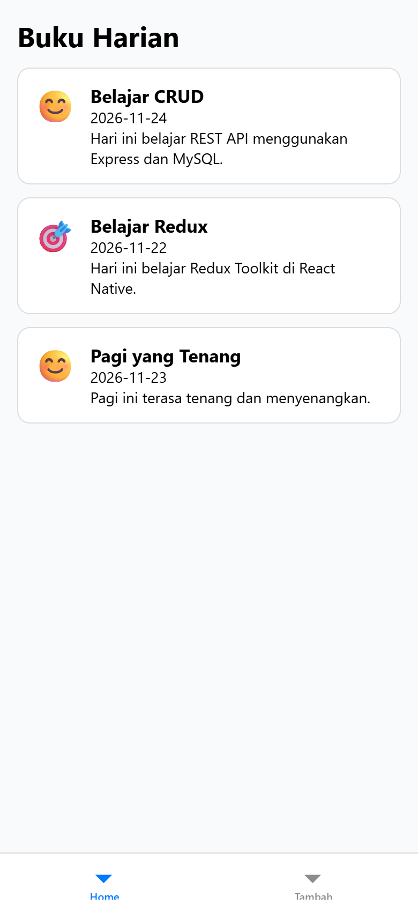
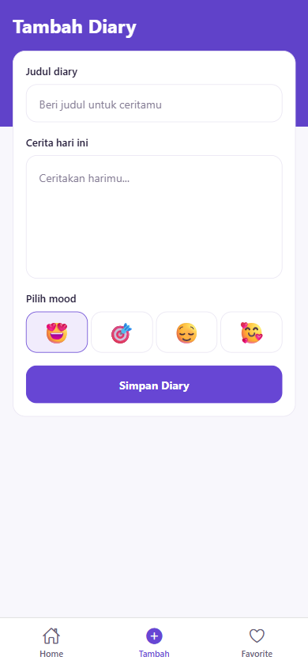

# Diary App - Pertemuan 9: CRUD Diary App (Dasar)

Aplikasi Diary berbasis React Native dan Expo yang dikembangkan untuk praktikum mata kuliah **Pemrograman Mobile Multiplatform**. Pada pertemuan 9 ini, aplikasi menerapkan arsitektur full-stack end-to-end yang mengintegrasikan frontend mobile, state management global, RESTful API backend, dan database relasional MySQL serta pengujian komprehensif menggunakan Postman.

---

## Disusun Oleh

- **Nama:** Muhamad Dikrulloh
- **NIM:** 2430511076
- **Program Studi:** Teknik Informatika
- **Fakultas:** Sains dan Teknologi
- **Perguruan Tinggi:** Universitas Muhammadiyah Sukabumi

---

## Teknologi yang Digunakan

- **Frontend:** React Native (Expo SDK 58, Expo Router)
- **State Management:** Redux Toolkit (`createAsyncThunk`), React-Redux
- **Backend:** Node.js, Express.js, CORS, Dotenv, Mysql2 (Promise API)
- **Database:** MySQL / MariaDB (Database: `diary_app`, Tabel: `diaries`)
- **API Testing:** Postman API Platform (Lightweight & Collection v2.1)

---

## Alur Data Aplikasi (Data Flow)

Sesuai dengan panduan modul praktikum, alur data aplikasi berjalan satu arah:

```text
React Native Screen (UI)
        ↓
    dispatch()
        ↓
Redux Toolkit (createAsyncThunk)
        ↓
api.ts (fetch HTTP Client)
        ↓
Express.js REST API (Port 3000)
        ↓
MySQL Database (diary_app)
        ↓
JSON Response
        ↓
Redux Store (diarySlice)
        ↓
UI Diperbarui Otomatis
```

---

## Struktur Direktori Project

```text
.
├── app/
│   ├── (tabs)/
│   │   ├── _layout.tsx      # Tab Navigator (Home & Tambah)
│   │   ├── index.tsx        # Screen Home (Daftar Buku Harian)
│   │   └── create.tsx       # Screen Tambah Diary
│   ├── detail/
│   │   └── [id].tsx         # Screen Detail Diary (View & Delete)
│   ├── edit/
│   │   └── [id].tsx         # Screen Edit Diary (Update Form)
│   └── _layout.tsx          # Root Stack Navigator & Redux Provider
├── src/
│   ├── api.ts               # HTTP client (fetch wrapper: GET, POST, PUT, DELETE)
│   ├── diarySlice.ts        # Redux Slice & Async Thunks
│   ├── hooks.ts             # Typed hooks (useAppDispatch, useAppSelector)
│   └── store.ts             # Redux Store Configuration
├── backend/
│   ├── src/
│   │   └── server.js        # Express.js REST API Server
│   ├── package.json         # Dependency backend
│   └── schema.sql           # Skema DDL dan seed data MySQL
├── postman/
│   └── Diary_App_API.postman_collection.json # Postman Collection v2.1
└── assets/
    └── screenshots/
        ├── Home.png
        ├── Create.png
        ├── Detail.png
        ├── Edit.png
        └── postman/
            ├── 01_GET_all_diaries.png
            ├── 02_GET_single_diary.png
            ├── 03_POST_create_diary.png
            ├── 04_PUT_update_diary.png
            └── 05_DELETE_diary.png
```

---

## Cara Menjalankan Project

### 1. Persiapan Database MySQL

1. Pastikan layanan MySQL/MariaDB (misal: Laragon, XAMPP) telah aktif.
2. Eksekusi script SQL yang berada di `backend/schema.sql` untuk membuat database `diary_app` dan tabel `diaries`.

```sql
CREATE DATABASE IF NOT EXISTS diary_app;
USE diary_app;

CREATE TABLE IF NOT EXISTS diaries (
  id INT AUTO_INCREMENT PRIMARY KEY,
  title VARCHAR(150) NOT NULL,
  diary_date DATE NOT NULL,
  body TEXT NOT NULL,
  mood VARCHAR(20) DEFAULT '😊',
  created_at TIMESTAMP DEFAULT CURRENT_TIMESTAMP
);
```

### 2. Menjalankan Backend REST API

1. Masuk ke folder backend:
   ```bash
   cd backend
   ```
2. Install dependencies:
   ```bash
   npm install
   ```
3. Siapkan file konfigurasi environment `.env` di dalam folder `backend/`:
   ```env
   PORT=3000
   DB_HOST=localhost
   DB_PORT=3306
   DB_USER=root
   DB_PASSWORD=
   DB_NAME=diary_app
   ```
4. Jalankan server backend:
   ```bash
   npm run dev
   ```
   *Server akan berjalan di `http://localhost:3000`*.

### 3. Menjalankan Aplikasi Mobile (Frontend)

1. Dari root folder project, install dependencies:
   ```bash
   npm install
   ```
2. Siapkan file konfigurasi environment `.env` di root folder:
   ```env
   EXPO_PUBLIC_API_URL=http://localhost:3000
   ```
   *(Catatan: Jika menguji menggunakan HP fisik / Expo Go di jaringan Wi-Fi lokal, ganti `localhost` dengan alamat IPv4 komputer Anda, contoh: `http://192.168.1.10:3000`)*.
3. Jalankan aplikasi Expo:
   ```bash
   npx expo start -c
   ```
4. Tekan tombol `w` untuk membuka versi Web, atau pindai QR code melalui Expo Go pada perangkat Android/iOS.

---

## Dokumentasi Pengujian REST API dengan Postman

Pengujian endpoint REST API dilakukan mengacu pada **Poin 10 Modul Praktikum 09** untuk memastikan seluruh fungsi CRUD pada backend berjalan normal sebelum dihubungkan ke aplikasi mobile.

File koleksi Postman siap pakai telah disediakan di:  
📂 `postman/Diary_App_API.postman_collection.json` *(Format Collection v2.1)*.

### Ringkasan Endpoint

| No | Operasi | HTTP Method | Endpoint | Status Code | Deskripsi |
|:--:|:--------|:-----------:|:---------|:-----------:|:----------|
| 1 | Read All | `GET` | `/api/diaries` | `200 OK` | Mengambil seluruh daftar diary (diurutkan DESC berdasarkan ID) |
| 2 | Read One | `GET` | `/api/diaries/:id` | `200 OK` | Mengambil detail satu data diary berdasarkan ID |
| 3 | Create | `POST` | `/api/diaries` | `201 Created` | Menambahkan catatan diary baru ke database MySQL |
| 4 | Update | `PUT` | `/api/diaries/:id` | `200 OK` | Memperbarui data diary yang ada berdasarkan ID |
| 5 | Delete | `DELETE` | `/api/diaries/:id` | `200 OK` | Menghapus data diary dari database berdasarkan ID |

---

### Bukti Pengujian Postman

#### 1. Test GET Semua Diary (10.1)
- **Method:** `GET`
- **URL:** `http://localhost:3000/api/diaries`
- **Hasil:** Status `200 OK`, mengembalikan array data diary berformat JSON.



---

#### 2. Test GET Satu Diary (10.2)
- **Method:** `GET`
- **URL:** `http://localhost:3000/api/diaries/1`
- **Hasil:** Status `200 OK`, mengembalikan satu objek diary lengkap dengan atribut `id`, `title`, `diary_date`, `body`, `mood`, dan `created_at`.



---

#### 3. Test POST / Create Diary (10.3)
- **Method:** `POST`
- **URL:** `http://localhost:3000/api/diaries`
- **Headers:** `Content-Type: application/json`
- **Body (raw JSON):**
  ```json
  {
    "title": "Belajar CRUD",
    "diary_date": "2026-11-24",
    "body": "Hari ini belajar REST API menggunakan Express dan MySQL.",
    "mood": "😊"
  }
  ```
- **Hasil:** Status `201 Created`, data berhasil disimpan ke MySQL dan mengembalikan objek baru beserta ID yang di-generate.



---

#### 4. Test PUT / Update Diary (10.4)
- **Method:** `PUT`
- **URL:** `http://localhost:3000/api/diaries/9`
- **Headers:** `Content-Type: application/json`
- **Body (raw JSON):**
  ```json
  {
    "title": "Belajar CRUD dan API",
    "diary_date": "2026-11-24",
    "body": "Hari ini memahami proses update data melalui REST API.",
    "mood": "🎯"
  }
  ```
- **Hasil:** Status `200 OK`, kolom pada baris data terkait berhasil diperbarui di database.



---

#### 5. Test DELETE Diary (10.5)
- **Method:** `DELETE`
- **URL:** `http://localhost:3000/api/diaries/9`
- **Hasil:** Status `200 OK`, mengembalikan pesan konfirmasi:
  ```json
  {
    "message": "Diary berhasil dihapus"
  }
  ```



---

## Dokumentasi Antarmuka Aplikasi Mobile

Berikut adalah tampilan visual setiap halaman pada aplikasi **Diary App** yang telah terintegrasi penuh dengan backend Express dan database MySQL:

### 1. Home Screen (`/`)
Menampilkan daftar buku harian yang diambil secara otomatis dari database MySQL melalui Redux Toolkit saat halaman dibuka. Emoji mood tersimpan dan ter-render langsung (`😊`, `🎯`).



---

### 2. Tambah Diary (`/create`)
Form untuk menambahkan diary baru yang berisi input Judul, Isi Diary, dan input Mood emoji dengan default `"😊"`. Ketika tombol **Simpan** ditekan, data dikirim melalui `POST` ke backend dan otomatis dialihkan ke Home.



---

### 3. Detail Diary (`/detail/[id]`)
Menampilkan isi catatan harian secara lengkap beserta emoji mood berukuran besar, tanggal, judul, dan isi cerita. Pada halaman ini disediakan opsi untuk menuju form **Edit** atau melakukan **Hapus** diary.


---

### 4. Edit Diary (`/edit/[id]`)
Form pengeditan data diary yang secara otomatis memuat (pre-fill) nilai judul, isi, dan mood yang ada sebelumnya. Menekan tombol **Simpan Perubahan** akan memicu `PUT` request ke backend dan mengembalikan tampilan ke halaman detail dengan data terbaru.


---

## Checklist Akhir Praktikum

Berdasarkan **Checklist Akhir Mahasiswa (Poin 27 Modul Praktikum 09)**:

- [x] Node.js dan npm siap digunakan.
- [x] MySQL aktif dan service berjalan normal.
- [x] Project backend dibuat terstruktur.
- [x] Dependencies backend terpasang (`express`, `mysql2`, `cors`, `dotenv`, `nodemon`).
- [x] `schema.sql` berhasil dijalankan dan tabel `diaries` terbuat.
- [x] Konfigurasi environment backend `.env` valid.
- [x] Server Express `server.js` berhasil berjalan di port `3000`.
- [x] Request `GET` berhasil diuji melalui browser.
- [x] Operasi CRUD berhasil diuji secara menyeluruh melalui Postman.
- [x] Project mobile `diary-app9` dibuat dengan template tabs (Expo Router).
- [x] Package `@reduxjs/toolkit` dan `react-redux` terpasang.
- [x] Folder `src/` berisi `api.ts`, `diarySlice.ts`, `store.ts`, dan `hooks.ts`.
- [x] Route dinamis `detail/[id].tsx` dan `edit/[id].tsx` berfungsi normal.
- [x] File `.env` mobile memiliki konfigurasi `EXPO_PUBLIC_API_URL`.
- [x] Halaman Home berhasil menampilkan data dari MySQL.
- [x] Fitur Create diary berhasil dan data masuk ke MySQL.
- [x] Fitur Edit diary berhasil memperbarui data di MySQL.
- [x] Fitur Delete diary berhasil menghapus data di MySQL.
- [x] Setelah aplikasi di-restart, data tetap persisten tersimpan di database MySQL.
