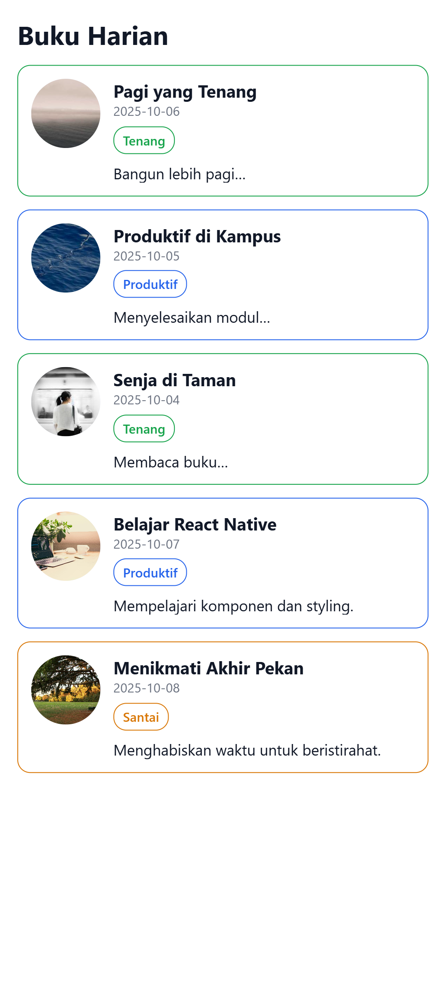
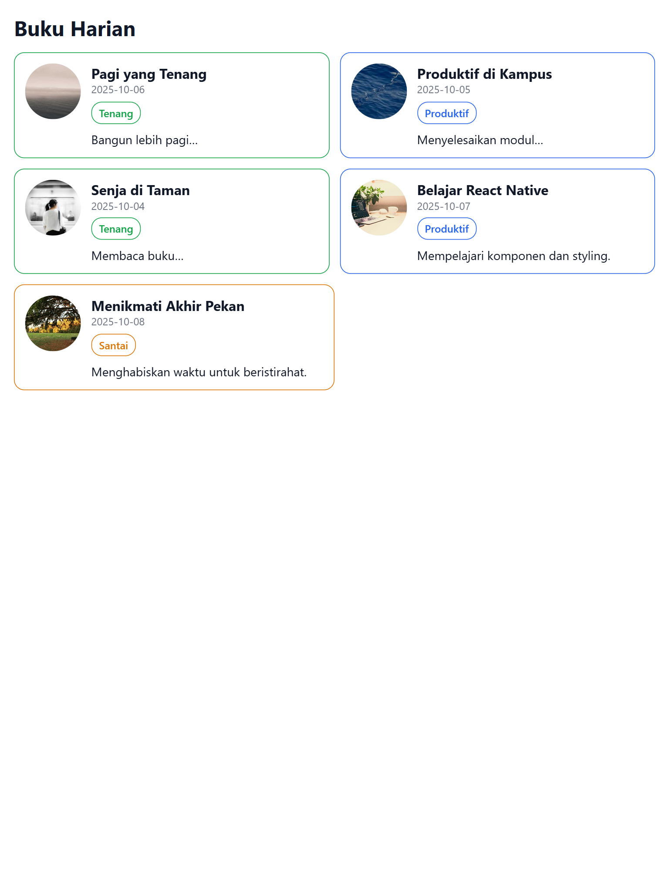
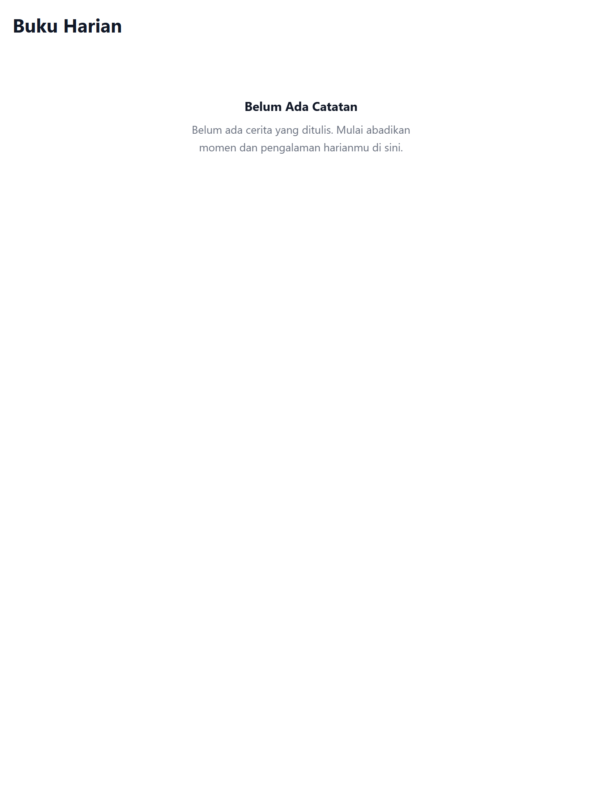

# Diary App - Pertemuan 3

Aplikasi Diary sederhana yang dibuat menggunakan React Native dan Expo sebagai bagian dari tugas praktikum Pemrograman Mobile Multiplatform.

## Disusun Oleh

**Nama:** Muhamad Dikrulloh  
**NIM:** 2430511076

## Cara Menjalankan Project

1. Clone repository atau download project.
2. Buka terminal pada folder project.
3. Install dependency:

   ```bash
   npm install
   ```

4. Jalankan aplikasi menggunakan Expo:

   ```bash
   npx expo start
   ```

5. Scan QR Code menggunakan Expo Go pada perangkat Android atau jalankan melalui emulator. Untuk menjalankan melalui browser, tekan `w` pada terminal Expo.

## Dependency

Project ini menggunakan:

- React Native
- Expo
- react-native-safe-area-context

## Fitur yang Diselesaikan

- Menampilkan lima entri diary dengan gambar lokal dan remote.
- Menerapkan `StyleSheet` dan design tokens agar tampilan konsisten.
- Membuat daftar diary responsif menggunakan `FlatList` dengan satu atau dua kolom sesuai ukuran layar.
- Menampilkan detail catatan melalui `DiaryDetailModal` ketika kartu ditekan.
- Menerapkan aksesibilitas dasar melalui label, kontras teks, dan ukuran area sentuh.
- Menambahkan badge mood dan variasi warna border kartu berdasarkan mood.
- Menampilkan empty state informatif ketika daftar diary kosong.
- Menambahkan skeleton loader sebagai placeholder sebelum data ditampilkan.

## Layout Responsif

Aplikasi menggunakan `useWindowDimensions` untuk menyesuaikan jumlah kolom berdasarkan lebar layar. Pada layar dengan lebar kurang dari 600 dp, daftar diary ditampilkan dalam satu kolom. Sementara itu, pada layar dengan lebar 600 dp atau lebih, daftar berubah menjadi dua kolom menggunakan `FlatList`.

## Screenshot

### Tampilan 1 Kolom (Mobile)

<p align="center">
  
</p>

### Tampilan 2 Kolom (Tablet)

<p align="center">
  
</p>

### Tampilan Empty State

<p align="center">
  
</p>
