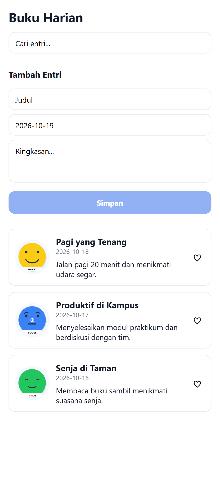
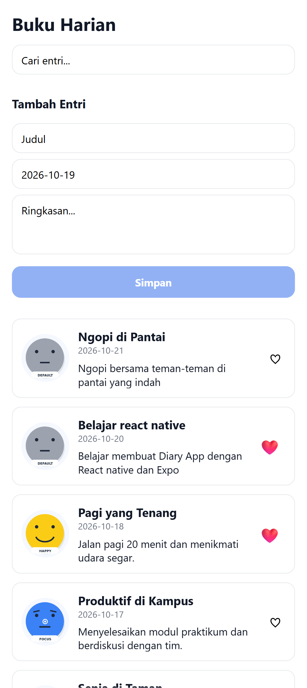

# Diary App - Pertemuan 4

Aplikasi Diary sederhana berbasis React Native dan Expo yang dikembangkan sebagai bagian dari praktikum Pemrograman Mobile Multiplatform. Pada pertemuan ini, aplikasi dikembangkan dengan penerapan Props dan State untuk mengelola data serta interaksi pengguna secara dinamis.

## Disusun Oleh

**Nama:** Muhamad Dikrulloh  
**NIM:** 2430511076

## Cara Menjalankan Project

1. Clone repository atau download project.
2. Buka terminal pada folder project.
3. Install dependency:

   ```bash
   npm install
   ```

4. Jalankan aplikasi menggunakan Expo:

   ```bash
   npx expo start
   ```

5. Scan QR Code menggunakan Expo Go atau jalankan melalui emulator. Untuk menjalankan melalui browser, tekan `w` pada terminal Expo.

## Dependency

Project ini menggunakan:

- React Native
- Expo
- react-native-safe-area-context

## Fitur yang Diselesaikan

- **DiaryCard:** Menampilkan entri menggunakan props dan callback.
- **SearchBar:** Mencari entri secara dinamis berdasarkan judul, tanggal, atau ringkasan.
- **EntryForm:** Menambahkan entri baru melalui controlled form.
- **Like:** Mengubah status suka tanpa memuat ulang aplikasi.
- **Detail Modal:** Menampilkan informasi lengkap entri yang dipilih.
- **State Management:** Mengelola `entries`, `query`, `likedIds`, dan `selected` menggunakan `useState`, serta memfilter data dengan `useMemo`.
- **Local Assets:** Menggunakan gambar lokal untuk menampilkan mood pada DiaryCard.

## Penerapan Props dan State

**Props** digunakan untuk mengirim data dan callback dari `DiaryListScreen` ke komponen seperti `DiaryCard`, `SearchBar`, dan `EntryForm`.

**State** digunakan untuk menyimpan dan memperbarui data aplikasi. Perubahan state secara otomatis memperbarui tampilan tanpa perlu menjalankan ulang aplikasi.

## Screenshot

### Sebelum Penambahan Entri

<p align="center">
  
</p>

### Sesudah Penambahan Entri

<p align="center">
  
</p>
