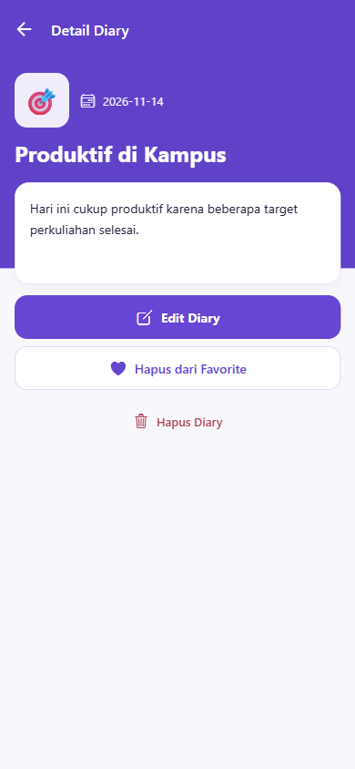
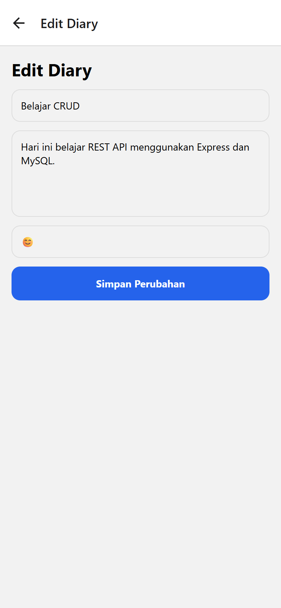
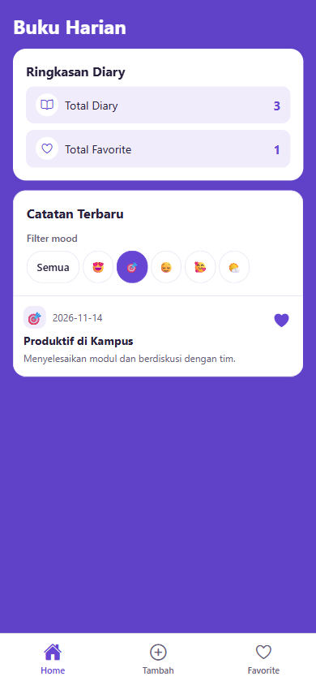
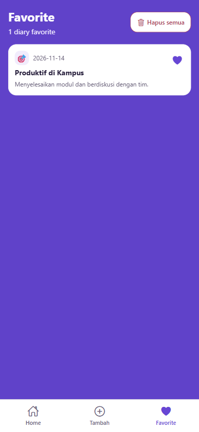
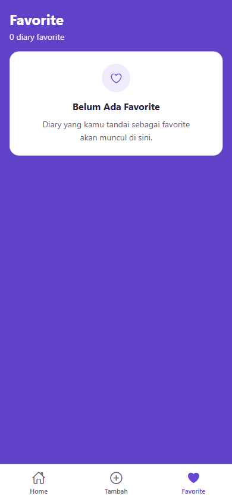
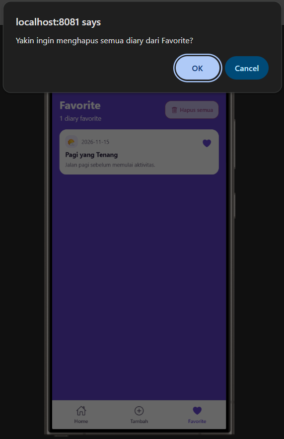

# Diary App - Pertemuan 8

Aplikasi Diary berbasis React Native dan Expo yang dikembangkan untuk praktikum Pemrograman Mobile Multiplatform. Pada pertemuan ini, aplikasi menerapkan Redux Toolkit dan React-Redux untuk mengelola data diary secara global, meliputi penambahan, pengeditan, penghapusan, pengelolaan favorite, filter mood, serta statistik diary.

## Disusun Oleh

**Nama:** Muhamad Dikrulloh  
**NIM:** 2430511076

## Cara Menjalankan Project

1. Clone repository pada branch `pertemuan-8`:

   ```bash
   git clone -b pertemuan-8 https://github.com/muhamaddikrulloh/diary-app.git
   ```

2. Masuk ke folder project:

   ```bash
   cd diary-app
   ```

3. Install dependency:

   ```bash
   npm install
   ```

4. Jalankan aplikasi:

   ```bash
   npx expo start
   ```

5. Buka aplikasi melalui Expo Go, emulator, atau browser.

## Struktur Project

```text
diary-app/
├── app/
│   ├── _layout.tsx
│   ├── (tabs)/
│   │   ├── _layout.tsx
│   │   ├── index.tsx
│   │   ├── create.tsx
│   │   └── favorites.tsx
│   ├── detail/
│   │   └── [id].tsx
│   └── edit/
│       └── [id].tsx
├── src/
│   ├── app/
│   │   ├── store.ts
│   │   └── hooks.ts
│   ├── features/
│   │   └── diary/
│   │       └── diarySlice.ts
│   ├── components/
│   │   ├── DiaryCard.tsx
│   │   ├── DiaryForm.tsx
│   │   └── EmptyState.tsx
│   └── styles/
│       └── tokens.ts
└── assets/
    └── screenshots/
```

Folder `app/` pada root project digunakan oleh Expo Router untuk seluruh halaman dan routing dinamis. Agar Expo Router tetap memakai folder tersebut (bukan `src/app/`), plugin `expo-router` pada `app.json` dikonfigurasi dengan `"root": "./app"`. Konfigurasi Redux Store, typed hooks, reducer diary, komponen, dan design tokens ditempatkan di dalam `src/`.

## Penerapan Redux Toolkit

Aplikasi menggunakan Redux Toolkit untuk mengelola data diary secara terpusat melalui Redux Store. Setiap perubahan data dilakukan menggunakan action dan reducer, sedangkan komponen membaca data terbaru melalui selector.

| Konsep   | Implementasi                         | Fungsi                                     |
| -------- | ------------------------------------ | ------------------------------------------ |
| Store    | `configureStore()`                   | Menyimpan global state aplikasi.           |
| Slice    | `createSlice()`                      | Mengelompokkan state dan reducer diary.    |
| Action   | `addDiary`, `editDiary`, dan lainnya | Menentukan perubahan yang akan dilakukan.  |
| Reducer  | `diarySlice.ts`                      | Memproses action dan memperbarui state.    |
| Provider | `Provider`                           | Menghubungkan Redux Store dengan aplikasi. |
| Dispatch | `useAppDispatch()`                   | Mengirim action ke Redux Store.            |
| Selector | `useAppSelector()`                   | Mengakses data dari Redux Store.           |

### Penerapan Reducer

| Reducer             | Fungsi                                                   |
| ------------------- | -------------------------------------------------------- |
| `addDiary`          | Menambahkan diary baru.                                  |
| `editDiary`         | Memperbarui judul, isi, dan mood diary.                  |
| `deleteDiary`       | Menghapus diary berdasarkan ID.                          |
| `toggleFavorite`    | Mengubah status favorite diary.                          |
| `clearAllFavorites` | Menghapus seluruh status favorite tanpa menghapus diary. |
| `setFilter`         | Mengatur filter global yang tersedia pada diary slice.   |

## Implementasi Tugas Praktikum

### 1. Edit Diary

Fitur edit memungkinkan pengguna memperbarui judul, isi, dan mood dari catatan yang sudah tersimpan. Data diary dicari berdasarkan ID menggunakan `find()`, kemudian perubahan diproses melalui reducer `editDiary`. Ringkasan atau preview juga diperbarui agar sesuai dengan isi terbaru.

### 2. Screen Edit Diary

Halaman `edit/[id].tsx` menggunakan Expo Router untuk menampilkan form berdasarkan ID diary. Input diisi dengan data sebelumnya menggunakan `useState`, sedangkan perubahan disimpan ke Redux Store melalui `dispatch(editDiary())`.

### 3. Filter Mood

Filter mood diterapkan pada halaman Home untuk menampilkan diary berdasarkan mood yang dipilih. Pemilihan filter menggunakan local state melalui `useState`, sedangkan daftar diary tetap berasal dari Redux Store. Penyaringan dilakukan menggunakan method `filter()` tanpa mengubah data aslinya.

### 4. Statistik Diary

Halaman Home menampilkan statistik Total Diary dan Total Favorite. Total Diary dihitung menggunakan `entries.length`, sedangkan Total Favorite dihitung berdasarkan jumlah diary dengan status `liked: true`. Statistik diperbarui secara otomatis ketika data Redux berubah.

### 5. Clear All Favorites

Reducer `clearAllFavorites` digunakan untuk mengubah seluruh status `liked` menjadi `false` menggunakan `forEach()`. Fitur ini dilengkapi dialog konfirmasi sebelum dijalankan. Proses tersebut hanya menghapus status favorite, bukan catatan diary.

### 6. Validasi Judul

Validasi diterapkan pada form Create dan Edit untuk memastikan judul memiliki minimal tiga karakter. Pemeriksaan menggunakan `trim().length` agar spasi di awal dan akhir tidak ikut dihitung. Isi diary juga wajib diisi sebelum data disimpan.

### 7. Empty State

Halaman Home dan Favorites memiliki tampilan informatif ketika daftar diary kosong. Pada Home, pesan dibedakan antara kondisi belum memiliki diary dan hasil filter mood yang tidak ditemukan. Pada Favorites, pesan ditampilkan ketika belum ada diary yang ditandai sebagai favorite.

## Perbedaan Local State, Global Redux State, dan Persistent Database

| Aspek          | Local State                                        | Global Redux State                                   | Persistent Database                                 |
| -------------- | -------------------------------------------------- | ---------------------------------------------------- | --------------------------------------------------- |
| Pengertian     | State yang dikelola dalam komponen.                | State yang dikelola secara terpusat.                 | Data yang disimpan pada media penyimpanan permanen. |
| Penggunaan     | Input form dan pilihan filter.                     | Daftar diary dan status favorite.                    | Penyimpanan data jangka panjang.                    |
| Akses          | Komponen terkait.                                  | Berbagai komponen melalui Redux Store.               | Melalui mekanisme akses database.                   |
| Ketahanan data | Hilang ketika state komponen diinisialisasi ulang. | Secara default hilang ketika aplikasi dimulai ulang. | Tetap tersimpan setelah aplikasi ditutup.           |
| Contoh         | `useState()`                                       | Redux Toolkit                                        | SQLite atau MySQL                                   |

Dalam aplikasi Diary ini, local state digunakan untuk mengelola input judul, isi, mood, dan pilihan filter. Redux Toolkit digunakan untuk mengelola daftar diary dan status favorite agar perubahan data dapat diakses secara konsisten dari berbagai halaman.

## Screenshot

### Tampilan Utama

|                  Home                  |                Create Diary                |
| :------------------------------------: | :----------------------------------------: |
|  |  |

|                Detail Diary                |               Edit Diary               |
| :----------------------------------------: | :------------------------------------: |
|  |  |

### Filter dan Favorite

|                Filter Mood                 |                    Favorites                     |
| :----------------------------------------: | :----------------------------------------------: |
|  |  |

### Hasil Pengujian

|                     Empty State                     |                     Clear All Favorites                     |
| :-------------------------------------------------: | :---------------------------------------------------------: |
|  |  |
